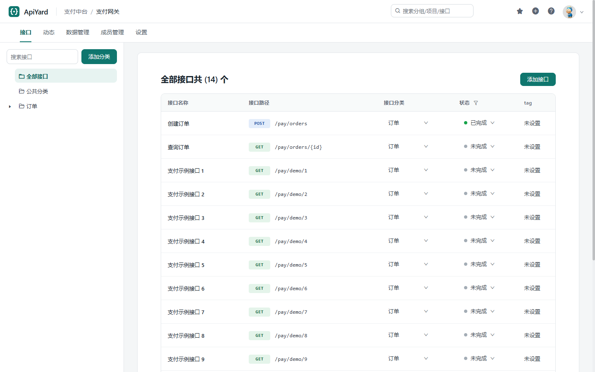

# ApiYard

兼容 YApi 的轻量接口管理平台：一个可执行文件就能部署，现有的 YApi 周边工具不用改就能接入。

> **开发预览**：v0.1 已经能从真实的 YApi 实例迁移过来日常使用，但还没有经过大量团队的长期使用。升级前请备份数据库，遇到问题欢迎[提 issue](https://github.com/PandaPanY/apiyard/issues)。

下一安全补丁版本见 [v0.1.1 发布说明草稿](docs/releases/v0.1.1.md)，包含 token 权限变化和升级步骤；当前尚未发布。



## 背景

[YApi](https://github.com/YMFE/yapi) 曾是国内最流行的自托管接口管理平台（27k+ Star），但 2022 年后已停止维护：

- 依赖 Node + MongoDB，版本陈旧，部署和升级都很麻烦；
- Mock 脚本沙箱存在**未修复的未授权远程代码执行漏洞**；
- 仍有大量团队在用，IDEA 插件、TypeScript 代码生成、MCP 等周边工具也仍在活跃更新。

ApiYard 用 Go 重新实现 YApi 的核心能力，让这些团队可以低成本、安全地迁移过来。架构设计见 [`docs/architecture.md`](docs/architecture.md)。

## 核心特性

- **单文件部署**：Go 编译，前端内嵌，默认使用 SQLite，不需要 MongoDB
- **兼容 YApi 开放 API**：15 个开放接口与 YApi 保持一致，easy-yapi、yapi-to-typescript、Yapi-MCP 等工具无需修改
- **一键迁移**：直接从 YApi 的 MongoDB（或 mongodump 导出的目录）导入用户、分组、项目、接口和动态，原有账号密码、token、接口链接都继续有效
- **安全的 Mock**：Mock 地址、Mock.js 规则和占位符与 YApi 一致，但不执行任何脚本，从根上消除原版的远程代码执行漏洞
- **内网友好**：去掉原版前端的 Google Analytics 统计和外部版本检查，不向外部站点发送任何数据
- **标准格式**：导入 OpenAPI 3 / Swagger 2，导出 Swagger 2、HTML、Markdown 和 JSON
- **熟悉的界面**：沿用 YApi 的页面结构和操作，换了新的配色、布局和登录页，迁移过来的用户不用重新学
- **AI 接入**（规划中，v0.2）：内置 MCP Server

## 开发目标

- [x] M0 立项：调研、架构设计、工程骨架
- [x] M0.5 前置验证：搭建 YApi 对照环境，验证能否沿用原有前端，搭好兼容测试框架
- [x] M1 账号与分组：SQLite 存储、登录会话、角色权限、用户 / 分组接口（24 个）
- [x] M2 项目与接口：项目 / 接口 / 动态接口（38 个），界面核心流程可用，公开仓库
- [x] M3 开放 API 与导入导出：token 兼容，导入 Swagger 2 / OpenAPI 3、导出 Swagger 2，周边工具实测（easy-yapi 为按源码回放）
- [x] M4 数据迁移：一条命令从 YApi 的 MongoDB 迁移，原密码、token、链接和 Mock 地址都继续有效
- [x] M5 Mock 服务：地址与 YApi 一致，支持 Mock.js 规则和占位符、JSON Schema、请求变量和严格模式，不执行脚本
- [x] M6 打包发布 v0.1：单文件、Docker 镜像、CI、文档，2026-11-10 发布 [v0.1.0](https://github.com/PandaPanY/apiyard/releases/tag/v0.1.0)
- [ ] M7 MCP Server（v0.2）：服务端内置 `/mcp`，用项目 token 鉴权，提供查接口、生成 Mock 示例、保存接口、导入导出 OpenAPI 等 9 个工具

**v0.1 发布标准**：完成 M0.5–M6，一个真实的 YApi 实例可以完整迁移过来并正常使用。每个里程碑的任务、验收标准和工时预估见 [`docs/roadmap.md`](docs/roadmap.md)。

**暂不做**：自动化测试集合、Wiki、统计、Swagger 自动同步、高级 Mock 脚本。

## 技术栈

- 语言：Go（标准库 `net/http`）
- 存储：SQLite（`modernc.org/sqlite`，纯 Go 实现，不需要 CGO），后续支持 PostgreSQL / MySQL
- 前端：第一阶段沿用 YApi 1.12 的预构建前端（React），由服务端换上 ApiYard 的名称、配色和登录页，之后逐步替换
- 其他依赖：`coder/websocket`（编辑冲突检测）、`yuin/goldmark`（导出 HTML 时渲染 Markdown），都是纯 Go 实现

## 快速开始

**可执行文件**：从 GitHub Releases 下载对应平台的压缩包（Linux、macOS、Windows，amd64 / arm64），解压后运行：

```bash
./apiyard -admin-password '初始密码'
```

**Docker**：

```bash
docker run -d --name apiyard -p 3000:3000 -v apiyard-data:/data \
  -e APIYARD_ADMIN_PASSWORD='初始密码' ghcr.io/pandapany/apiyard:0.1
```

浏览器打开 `http://localhost:3000`，用 `admin@admin.com` 和初始密码登录。不指定初始密码时会随机生成，只在首次启动的日志里出现一次。

配置项、反向代理、备份与升级见 [`docs/deployment.md`](docs/deployment.md)，与 YApi 的不同之处见 [`docs/differences.md`](docs/differences.md)。

### 从 YApi 迁移

```bash
# 预检：报告各类数据的数量、会跳过和修正的记录，不写入任何数据
apiyard migrate -mongo "mongodb://127.0.0.1:27017/yapi" -dry-run
# 正式迁移，然后用 YApi 配置文件里的 passsalt 启动
apiyard migrate -mongo "mongodb://127.0.0.1:27017/yapi" -db apiyard.db
apiyard -db apiyard.db -token-salt 原来的passsalt
```

MongoDB 低于 3.6 时，先用 `mongodump` 导出，再用 `-dump <目录>` 代替 `-mongo`。完整步骤（包括用 Docker 迁移）见 [`docs/migration.md`](docs/migration.md)。

## 开发

需要 Go 1.26 及以上版本。

```bash
go run ./tools/fetch-yapi-web     # 下载 YApi 的预构建前端（从 npm 下载 yapi-vendor 并校验），编译时打进可执行文件
go run ./cmd/apiyard -db apiyard-dev.db -admin-password ymfe.org
go test ./...
golangci-lint run                 # 代码检查，需要先安装 golangci-lint
```

- 接口兼容性测试（与原版 YApi 逐字段比对）见 [`docs/testing.md`](docs/testing.md)，对照实例见 [`testenv/yapi`](testenv/yapi/README.md)。
- 打包和发布见 [`docs/release.md`](docs/release.md)。

## 参与

- 问题和建议：[GitHub Issues](https://github.com/PandaPanY/apiyard/issues)。和 YApi 行为不一致的地方也算问题，请写明 YApi 的表现。
- 安全漏洞：请按 [SECURITY.md](SECURITY.md) 私下报告，不要公开发 issue。

## 许可证

[Apache-2.0](LICENSE)。本项目不隶属于 YApi 及其原作者；内嵌的 YApi 前端和沿用的代码见 [NOTICE](NOTICE)。
